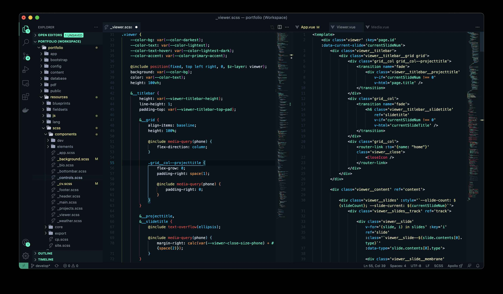

# Glasca VS Code Theme

Fork of [Athabasca Theme](https://github.com/ianlord/athabasca-vscode)

## Palette

*  `#0E141B` Black 1
*  `#070A0D` Black 2
*  `#3CAED7` Blue Bright 1
*  `#266D87` Blue Bright 2
*  `#30475F` Blue Dark 1
*  `#18242F` Blue Dark 2
*  `#AEC4DB` Blue Pale 1
*  `#8A96A8` Blue Pale 2
*  `#75FFCD` Green Bright 1
*  `#4BBE96` Green Bright 2
*  `#B0B3BA` Grey Bright 1
*  `#515B67` Grey Bright 2
*  `#FFB452` Orange Bright 1
*  `#F57542` Orange Bright 2
*  `#D64379` Pink Bright 1
*  `#A40E45` Pink Bright 2
*  `#BF33C7` Purple Bright 1
*  `#78217D` Purple Bright 2
*  `#F04242` Red Bright 1
*  `#A12626` Red Bright 2
*  `#FAFAFA` White 1
*  `#E6E6E6` White 2
*  `#F7EF9C` Yellow Bright 1
*  `#B3AC6B` Yellow Bright 2
*  `#F9EE86` Yellow Bright 3
*  `#0A1016` Background
*  `#0C151C` Background 2
*  `#192633` Divider
*  `#30475F` Divider 2

## Screenshot

